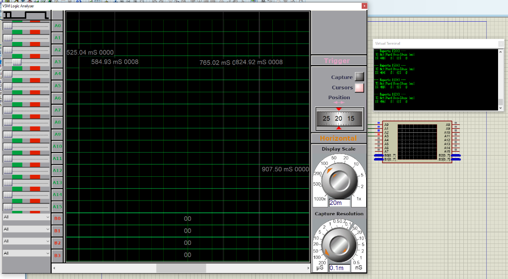
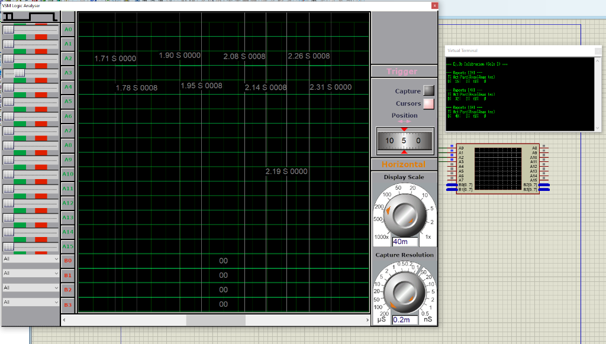
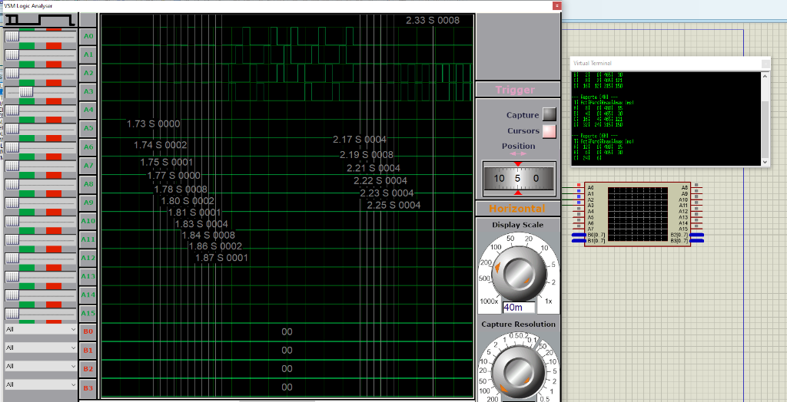
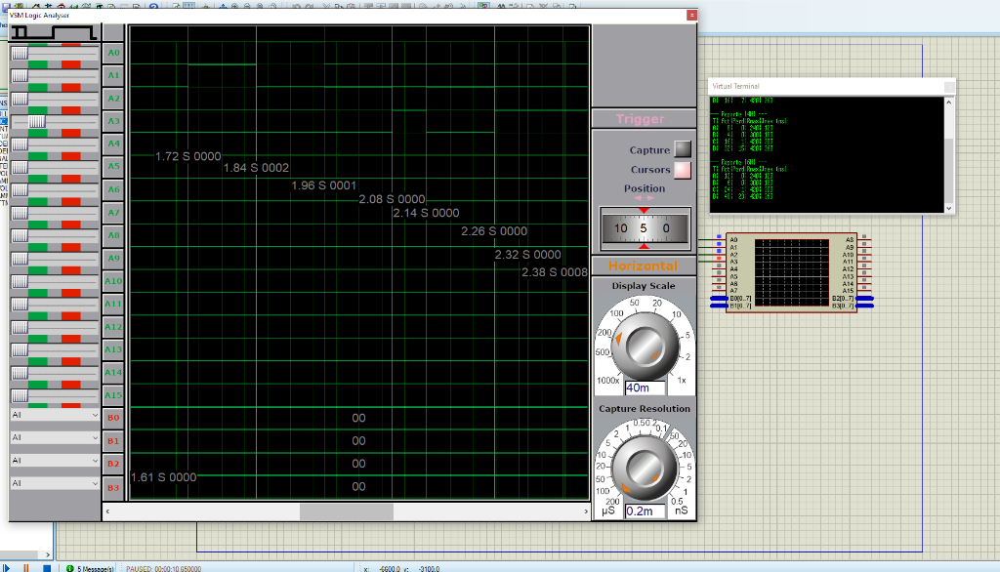

# Sistemas de Tiempo Real — Práctica 3
## Planificación de procesos de tiempo real. FreeRTOS.

---

## Parte I: Análisis y Planificación Manual

### Ejercicio 1

Conjunto de tareas periódicas síncronas ($S_i = 0$) con plazo igual al período ($D_i = T_i$):

| Tarea | Tiempo de ejecución ($C_i$) | Período / Plazo ($T_i = D_i$) | Utilización individual ($U_i = C_i / T_i$) |
| :---: | :---: | :---: | :---: |
| **A** | $2$ | $12$ | $2/12 = 1/6 \approx 0.1667$ |
| **B** | $2$ | $24$ | $2/24 = 1/12 \approx 0.0833$ |
| **C** | $2$ | $6$ | $2/6 = 1/3 \approx 0.3333$ |
| **D** | $1$ | $3$ | $1/3 \approx 0.3333$ |

---

#### a) Viabilidad, factor de utilización y cota de Liu y Layland

1. **Cálculo del factor de utilización total ($U$):**
   $$U = \sum_{i=1}^{4} \frac{C_i}{T_i} = \frac{2}{12} + \frac{2}{24} + \frac{2}{6} + \frac{1}{3} = \frac{4 + 2 + 8 + 8}{24} = \frac{22}{24} = \frac{11}{12} \approx 0.9167 \text{ (91.67\%)}$$
   Como $U = 11/12 \le 1$, se cumple la condición necesaria de planificabilidad en un único procesador (y para planificadores óptimos dinámicos como **EDF**, al ser $D_i = T_i$, $U \le 1$ es condición necesaria y suficiente, garantizando que **existe planificación viable**).

2. **Comparación con la cota de Liu y Layland para Rate Monotonic ($n = 4$):**
   $$U_{\text{LL}}(4) = 4\left(2^{1/4} - 1\right) \approx 4 \times (1.189207 - 1) \approx 0.7568 \text{ (75.68\%)}$$
   Comparando ambos valores:
   $$U \approx 0.9167 > U_{\text{LL}}(4) \approx 0.7568$$

3. **¿Resulta suficiente dicha cota para decidir?**
   **No.** La cota de Liu y Layland es una **condición suficiente pero no necesaria** para la política *Rate Monotonic* (RM). Como $U > U_{\text{LL}}(4)$, el test de Liu y Layland resulta **inconcluyente** (no permite afirmar ni descartar la planificabilidad bajo RM) y se debe recurrir a un criterio exacto.

4. **Comprobación exacta de viabilidad bajo prioridades fijas (Rate Monotonic):**
   Asignando prioridades fijas según **RM** (a menor período, mayor prioridad):
   $$\text{Prioridad}(D) > \text{Prioridad}(C) > \text{Prioridad}(A) > \text{Prioridad}(B) \quad (T_D = 3 < T_C = 6 < T_A = 12 < T_B = 24)$$

   Podemos demostrar que es planificable por dos vías equivalentes del apunte:
   - **Vía 1 — Conjunto periódico simple (armónico):** Para todo par de tareas con $T_i < T_k$, $T_k$ es múltiplo entero de $T_i$ ($3 \mid 6 \mid 12 \mid 24$). Por el teorema de conjuntos periódicos simples (Apunte §5.6.1), el sistema es planificable bajo RM **si y solo si** $U \le 1$. Como $U = 11/12 \le 1$, **es planificable**.
   - **Vía 2 — Análisis del Tiempo de Respuesta ($R_i$):** Calculamos iterativamente $w_i^{k+1} = C_i + \sum_{j \in hp(i)} \lceil w_i^k / T_j \rceil C_j$ hasta converger:
     - **Tarea D** (máxima prioridad): $R_D = C_D = 1 \le 3$ ✔
     - **Tarea C** ($hp(C) = \{D\}$):
       - $w_C^0 = 2$
       - $w_C^1 = 2 + \lceil 2/3 \rceil \cdot 1 = 3$
       - $w_C^2 = 2 + \lceil 3/3 \rceil \cdot 1 = 3 \implies R_C = 3 \le 6$ ✔
     - **Tarea A** ($hp(A) = \{D, C\}$):
       - $w_A^0 = 2$
       - $w_A^1 = 2 + \lceil 2/3 \rceil (1) + \lceil 2/6 \rceil (2) = 2 + 1 + 2 = 5$
       - $w_A^2 = 2 + \lceil 5/3 \rceil (1) + \lceil 5/6 \rceil (2) = 2 + 2 + 2 = 6$
       - $w_A^3 = 2 + \lceil 6/3 \rceil (1) + \lceil 6/6 \rceil (2) = 6 \implies R_A = 6 \le 12$ ✔
     - **Tarea B** ($hp(B) = \{D, C, A\}$):
       - $w_B^0 = 2$
       - $w_B^1 = 2 + \lceil 2/3 \rceil (1) + \lceil 2/6 \rceil (2) + \lceil 2/12 \rceil (2) = 2 + 1 + 2 + 2 = 7$
       - $w_B^2 = 2 + \lceil 7/3 \rceil (1) + \lceil 7/6 \rceil (2) + \lceil 7/12 \rceil (2) = 2 + 3 + 4 + 2 = 11$
       - $w_B^3 = 2 + \lceil 11/3 \rceil (1) + \lceil 11/6 \rceil (2) + \lceil 11/12 \rceil (2) = 2 + 4 + 4 + 2 = 12$
       - $w_B^4 = 2 + \lceil 12/3 \rceil (1) + \lceil 12/6 \rceil (2) + \lceil 12/12 \rceil (2) = 12 \implies R_B = 12 \le 24$ ✔

   **Conclusión 1(a):** Como $\forall i, R_i \le D_i$, **existe una planificación de tiempo real viable** (incluso con prioridades fijas RM).

---

#### b) Plan cíclico: período principal, período secundario y tabla del ejecutivo cíclico

1. **Período principal (Hiperperíodo $H$):**
   $$H = \operatorname{mcm}(T_A, T_B, T_C, T_D) = \operatorname{mcm}(12, 24, 6, 3) = 24 \text{ unidades de tiempo}$$

2. **Elección y justificación del período secundario (tamaño de trama $f$):**
   De acuerdo con el Apunte (§5.5.3, Ecuaciones 1 a 3), el tamaño de trama $f$ debe verificar tres condiciones:
   - **Condición 1 — Las tareas caben completas en una trama:**
     $$f \ge \max_{1 \le i \le n}(C_i) = \max(2, 2, 2, 1) = 2$$
   - **Condición 2 — Cantidad entera de tramas en el hiperperíodo ($f$ divide a algún $T_i$ y por ende a $H$):**
     $$\frac{H}{f} \in \mathbb{Z} \implies f \in \{1, 2, 3, 4, 6, 8, 12, 24\}$$
     (Todos ellos dividen también a $T_B = 24$). Combinando con la Condición 1 ($f \ge 2$), los candidatos se reducen a $f \in \{2, 3, 4, 6, 8, 12, 24\}$.
   - **Condición 3 — Al menos una trama completa entre la activación y el plazo de toda tarea:**
     $$2f - \operatorname{mcd}(T_i, f) \le D_i \quad \forall i \in \{A, B, C, D\}$$
     La restricción más exigente corresponde a la **Tarea D** ($T_D = D_D = 3$):
     - Si $f \ge 4$: para $f = 4$, $2(4) - \operatorname{mcd}(3, 4) = 8 - 1 = 7 > 3$ (no cumple); para $f = 6$, $12 - 3 = 9 > 3$; para $f = 8$, $16 - 1 = 15 > 3$; para $f = 12$, $24 - 3 = 21 > 3$; para $f = 24$, $48 - 3 = 45 > 3$. Quedan descartados todos los candidatos $f \ge 4$.
     - Si **$f = 3$**:
       - Tarea D ($T_D = 3$): $2(3) - \operatorname{mcd}(3, 3) = 6 - 3 = 3 \le 3$ ✔
       - Tarea C ($T_C = 6$): $2(3) - \operatorname{mcd}(6, 3) = 6 - 3 = 3 \le 6$ ✔
       - Tarea A ($T_A = 12$): $2(3) - \operatorname{mcd}(12, 3) = 6 - 3 = 3 \le 12$ ✔
       - Tarea B ($T_B = 24$): $2(3) - \operatorname{mcd}(24, 3) = 6 - 3 = 3 \le 24$ ✔
     - *(Observación sobre $f = 2$)*: Si bien $f = 2$ verifica algebraicamente las tres desigualdades (para D: $4 - \operatorname{mcd}(3, 2) = 3 \le 3$), no permite alojar las tareas sin subdividirlas: las 8 instancias de D ($C_D = 1$) ocupan 8 de las 12 tramas de duración $2$, dejando en ellas solo $1$ unidad libre, quedando únicamente $4$ tramas libres de tamaño $2$ para ubicar $7$ trabajos de duración $2$ (4 de C, 2 de A y 1 de B). Además, siguiendo el criterio del algoritmo INF (Apunte §5.5.4), siempre se comienza probando el **mayor** $f$ válido para minimizar la sobrecarga del planificador.

   Por lo tanto, se adopta:
   - **Período principal:** $H = 24$
   - **Período secundario:** $f = 3$
   - **Número de tramas por hiperperíodo:** $F = H / f = 24 / 3 = 8$ tramas ($k = 0, 1, \dots, 7$).

3. **Tabla de tareas para el ejecutivo cíclico ($H = 24$, $f = 3$):**

| Trama $k$ | Intervalo $[t_k, t_{k+1})$ | Tareas ejecutadas (en orden) | Tiempo consumido | Tiempo ocioso | Verificación de ventanas $[r, d]$ |
| :---: | :---: | :---: | :---: | :---: | :--- |
| **0** | $[0, 3)$ | **D, C** | $1 + 2 = 3$ | $0$ | $D_1 \in [0,3]$, $C_1 \in [0,6]$ |
| **1** | $[3, 6)$ | **D, A** | $1 + 2 = 3$ | $0$ | $D_2 \in [3,6]$, $A_1 \in [0,12]$ |
| **2** | $[6, 9)$ | **D, C** | $1 + 2 = 3$ | $0$ | $D_3 \in [6,9]$, $C_2 \in [6,12]$ |
| **3** | $[9, 12)$ | **D, B** | $1 + 2 = 3$ | $0$ | $D_4 \in [9,12]$, $B_1 \in [0,24]$ |
| **4** | $[12, 15)$ | **D, C** | $1 + 2 = 3$ | $0$ | $D_5 \in [12,15]$, $C_3 \in [12,18]$ |
| **5** | $[15, 18)$ | **D, A** | $1 + 2 = 3$ | $0$ | $D_6 \in [15,18]$, $A_2 \in [12,24]$ |
| **6** | $[18, 21)$ | **D, C** | $1 + 2 = 3$ | $0$ | $D_7 \in [18,21]$, $C_4 \in [18,24]$ |
| **7** | $[21, 24)$ | **D** *(+ Idle)* | $1$ | $2$ | $D_8 \in [21,24]$ |

*(Total ejecutado: $22$ u de $24 \implies U = 22/24 = 11/12$).*

---

#### c) Cronograma de ejecución en $[0, 24]$ bajo prioridades fijas (Rate Monotonic)

Considerando las prioridades fijas de **Rate Monotonic** asociadas al análisis de 1(a) ($\text{Pr}(D) > \text{Pr}(C) > \text{Pr}(A) > \text{Pr}(B)$) con activación síncrona en $t = 0$:

```text
Tiempo:  0  1  2  3  4  5  6  7  8  9 10 11 12 13 14 15 16 17 18 19 20 21 22 23 24
         |--|--|--|--|--|--|--|--|--|--|--|--|--|--|--|--|--|--|--|--|--|--|--|--|
Tarea D: [██]     [██]     [██]     [██]     [██]     [██]     [██]     [██]
         ↑        ↑        ↑        ↑        ↑        ↑        ↑        ↑
Tarea C: ∙∙∙[█████]        ∙∙∙[█████]        ∙∙∙[█████]        ∙∙∙[█████]
         ↑                 ↑                 ↑                 ↑
Tarea A: ∙∙∙∙∙∙∙∙∙∙∙∙[█████]                 ∙∙∙∙∙∙∙∙∙∙∙∙[█████]
         ↑                                   ↑
Tarea B: ∙∙∙∙∙∙∙∙∙∙∙∙∙∙∙∙∙∙∙∙∙∙∙∙∙∙∙∙∙∙[█████]
         ↑
CPU    : |D |  C  |D |  A  |D |  C  |D |  B  |D |  C  |D |  A  |D |  C  |D | Idle|
         0  1     3  4     6  7     9  10    12 13    15 16    18 19    21 22    24

Referencias:  ↑ = Activación de la tarea    [██] = Ejecutando en CPU    ∙∙∙ = En cola de Listos (espera)
```

**Análisis de instantes de expropiación:**
- **No se produce ninguna expropiación en mitad de ráfaga (0 expropiaciones) en todo el hiperperíodo $[0, 24]$.**
- **Justificación:** La tarea de máxima prioridad (**D**, con $C_D = 1$ y $T_D = 3$) deja libre exactamente un hueco de $T_D - C_D = 3 - 1 = 2$ unidades en cada período ($[1,3)$, $[4,6)$, $[7,9)$, etc.). Como todas las demás tareas tienen tiempo de cómputo $C_C = C_A = C_B = 2$, cada vez que C, A o B toman la CPU en $t = 3k + 1$, **finalizan exactamente su ráfaga en $t = 3k + 3$**, justo en el mismo instante en que arriba la nueva activación de D (y eventualmente C o A).
- Sí existe **postergación inicial en la cola de listos** cuando varias tareas se activan simultáneamente ($t = 0, 6, 12, 18$), pero ninguna tarea que ya comenzó a ejecutar es desalojada antes de concluir su cómputo $C_i$. *(Nota: esto hace que el cronograma resultante bajo RM coincida exactamente con la tabla del ejecutivo cíclico de 1b).*

---

### Ejercicio 2

Conjunto de tareas periódicas síncronas ($S_i = 0$) con plazo igual al período ($D_i = T_i$):

| Tarea | Tiempo de ejecución ($C_i$) | Período / Plazo ($T_i = D_i$) | Utilización individual ($U_i = C_i / T_i$) |
| :---: | :---: | :---: | :---: |
| **A** | $1$ | $10$ | $1/10 = 0.10$ |
| **B** | $3$ | $12$ | $3/12 = 0.25$ |
| **C** | $7$ | $20$ | $7/20 = 0.35$ |
| **D** | $1$ | $5$ | $1/5 = 0.20$ |

---

#### a) Comprobación de existencia de una planificación de tiempo real viable

1. **Factor de utilización total ($U$):**
   $$U = \frac{1}{10} + \frac{3}{12} + \frac{7}{20} + \frac{1}{5} = \frac{6 + 15 + 21 + 12}{60} = \frac{54}{60} = 0.90 \text{ (90\%)}$$

2. **Viabilidad general (planificadores dinámicos óptimos — EDF):**
   Dado que las tareas son independientes, interrumpibles y cumplen $D_i = T_i$, por el teorema de planificabilidad de **EDF** (Apunte §5.7.2) la condición $U = 0.90 \le 1$ es necesaria y suficiente. Como EDF es óptimo, queda garantizado que **sí existe una planificación de tiempo real viable**.

3. **Comprobación adicional bajo prioridades fijas (Rate Monotonic):**
   - La cota de Liu y Layland para $n = 4$ es $U_{\text{LL}}(4) \approx 0.7568$. Como $U = 0.90 > 0.7568$ y el conjunto **no** es armónico ($12$ no es múltiplo de $5$ ni de $10$, y $20$ no es múltiplo de $12$), aplicamos el **Análisis del Tiempo de Respuesta (RTA)** con orden de prioridades RM ($\text{Pr}(D) > \text{Pr}(A) > \text{Pr}(B) > \text{Pr}(C)$):
     - **Tarea D** ($T_D = 5, C_D = 1$):
       $$R_D = C_D = 1 \le 5 \quad \checkmark$$
     - **Tarea A** ($T_A = 10, C_A = 1$, $hp(A) = \{D\}$):
       - $w_A^0 = 1$
       - $w_A^1 = 1 + \lceil 1/5 \rceil (1) = 2$
       - $w_A^2 = 1 + \lceil 2/5 \rceil (1) = 2 \implies R_A = 2 \le 10 \quad \checkmark$
     - **Tarea B** ($T_B = 12, C_B = 3$, $hp(B) = \{D, A\}$):
       - $w_B^0 = 3$
       - $w_B^1 = 3 + \lceil 3/5 \rceil (1) + \lceil 3/10 \rceil (1) = 3 + 1 + 1 = 5$
       - $w_B^2 = 3 + \lceil 5/5 \rceil (1) + \lceil 5/10 \rceil (1) = 3 + 1 + 1 = 5 \implies R_B = 5 \le 12 \quad \checkmark$
     - **Tarea C** ($T_C = 20, C_C = 7$, $hp(C) = \{D, A, B\}$):
       - $w_C^0 = 7$
       - $w_C^1 = 7 + \lceil 7/5 \rceil (1) + \lceil 7/10 \rceil (1) + \lceil 7/12 \rceil (3) = 7 + 2 + 1 + 3 = 13$
       - $w_C^2 = 7 + \lceil 13/5 \rceil (1) + \lceil 13/10 \rceil (1) + \lceil 13/12 \rceil (3) = 7 + 3 + 2 + 6 = 18$
       - $w_C^3 = 7 + \lceil 18/5 \rceil (1) + \lceil 18/10 \rceil (1) + \lceil 18/12 \rceil (3) = 7 + 4 + 2 + 6 = 19$
       - $w_C^4 = 7 + \lceil 19/5 \rceil (1) + \lceil 19/10 \rceil (1) + \lceil 19/12 \rceil (3) = 7 + 4 + 2 + 6 = 19 \implies R_C = 19 \le 20 \quad \checkmark$

   **Conclusión 2(a):** Todos los peores tiempos de respuesta cumplen $R_i \le D_i$, por lo que el sistema **es viable tanto bajo prioridades dinámicas (EDF) como bajo prioridades estáticas (RM)**.

---

#### b) Plan cíclico: verificación de las tres condiciones, modificación mínima y tabla del ejecutivo

1. **Período principal (Hiperperíodo $H$):**
   $$H = \operatorname{mcm}(10, 12, 20, 5) = 60 \text{ unidades de tiempo}$$

2. **Verificación una por una de las tres condiciones sobre el conjunto original:**
   - **Condición 1 — Ecu. (1):** Cada tarea debe caber sin subdividirse en una trama:
     $$f \ge \max(C_A, C_B, C_C, C_D) = \max(1, 3, 7, 1) = 7$$
   - **Condición 2 — Ecu. (2):** $f$ debe dividir al hiperperíodo $H = 60$ (y a algún $T_i$ para que $F = H/f$ sea entero):
     - Divisores de $H = 60$: $f \in \{1, 2, 3, 4, 5, 6, 10, 12, 15, 20, 30, 60\}$.
     - *(Nota: $15, 30, 60$ dividen a $H$ aunque no dividen a ningún $T_i$ individual; los incluimos igualmente en el chequeo exhaustivo).*
   - **Condición 3 — Ecu. (3):** Debe cumplirse $2f - \operatorname{mcd}(T_i, f) \le D_i$ para **todas** las tareas $i \in \{A, B, C, D\}$.

   Evaluamos sistemáticamente las tres condiciones para cada divisor de $H = 60$:

   | Candidato $f$ | Cond. 1 ($f \ge 7$) | Cond. 2 ($f \mid H$ / $f \mid T_i$) | Cond. 3 en D ($\le 5$) | Cond. 3 en A ($\le 10$) | Cond. 3 en B ($\le 12$) | Cond. 3 en C ($\le 20$) | ¿Válido? |
   | :---: | :---: | :---: | :---: | :---: | :---: | :---: | :---: |
   | **1** | ✘ ($1 < 7$) | ✔ ($F=60$) | $2-1 = 1$ ✔ | $2-1 = 1$ ✔ | $2-1 = 1$ ✔ | $2-1 = 1$ ✔ | **No** (falla C1) |
   | **2** | ✘ ($2 < 7$) | ✔ ($F=30$) | $4-1 = 3$ ✔ | $4-2 = 2$ ✔ | $4-2 = 2$ ✔ | $4-2 = 2$ ✔ | **No** (falla C1) |
   | **3** | ✘ ($3 < 7$) | ✔ ($F=20$) | $6-1 = 5$ ✔ | $6-1 = 5$ ✔ | $6-3 = 3$ ✔ | $6-1 = 5$ ✔ | **No** (falla C1) |
   | **4** | ✘ ($4 < 7$) | ✔ ($F=15$) | $8-1 = 7$ ✘ | $8-2 = 6$ ✔ | $8-4 = 4$ ✔ | $8-4 = 4$ ✔ | **No** (falla C1, C3) |
   | **5** | ✘ ($5 < 7$) | ✔ ($F=12$) | $10-5 = 5$ ✔ | $10-5 = 5$ ✔ | $10-1 = 9$ ✔ | $10-5 = 5$ ✔ | **No** (falla C1) |
   | **6** | ✘ ($6 < 7$) | ✔ ($F=10$) | $12-1 = 11$ ✘ | $12-2 = 10$ ✔ | $12-6 = 6$ ✔ | $12-2 = 10$ ✔ | **No** (falla C1, C3) |
   | **10** | ✔ ($10 \ge 7$) | ✔ ($F=6$) | $20-5 = 15$ ✘ | $20-10 = 10$ ✔ | $20-2 = 18$ ✘ | $20-10 = 10$ ✔ | **No** (falla C3) |
   | **12** | ✔ ($12 \ge 7$) | ✔ ($F=5$) | $24-1 = 23$ ✘ | $24-2 = 22$ ✘ | $24-12 = 12$ ✔ | $24-4 = 20$ ✔ | **No** (falla C3) |
   | **15** | ✔ ($15 \ge 7$) | $15 \mid H$ (✘ $T_i$) | $30-5 = 25$ ✘ | $30-5 = 25$ ✘ | $30-3 = 27$ ✘ | $30-5 = 25$ ✘ | **No** (falla C2, C3) |
   | **20** | ✔ ($20 \ge 7$) | ✔ ($F=3$) | $40-5 = 35$ ✘ | $40-10 = 30$ ✘ | $40-4 = 36$ ✘ | $40-20 = 20$ ✔ | **No** (falla C3) |
   | **30** | ✔ ($30 \ge 7$) | $30 \mid H$ (✘ $T_i$) | $60-5 = 55$ ✘ | $60-10 = 50$ ✘ | $60-6 = 54$ ✘ | $60-10 = 50$ ✘ | **No** (falla C2, C3) |
   | **60** | ✔ ($60 \ge 7$) | $60 \mid H$ (✘ $T_i$) | $120-5 = 115$ ✘ | $120-10 = 110$ ✘ | $120-12 = 108$ ✘ | $120-20 = 100$ ✘ | **No** (falla C2, C3) |

   > **Resultado explícito:** **Ningún candidato $f$ satisface simultáneamente las tres condiciones** sobre el conjunto original. La Condición 1 exige $f \ge 7$ (debido a $C_C = 7$), mientras que las Condiciones 2 y 3 solo admiten $f \in \{1, 2, 3, 5\}$ (impuesto principalmente por $D_D = 5$, que exige $f \le 5$).

3. **Propuesta de modificación mínima al conjunto de tareas:**
   Siguiendo el procedimiento de subdivisión en rodajas (*slices*) del Apunte (§5.5.3 y algoritmo INF §5.5.4):
   - Tomamos el **mayor período secundario** que cumple las Condiciones 2 y 3: **$f = 5$** (lo que da $F = 60 / 5 = 12$ tramas y minimiza el número de conmutaciones y subdivisiones).
   - Con $f = 5$, las tareas A ($C_A = 1$), B ($C_B = 3$) y D ($C_D = 1$) ya cumplen $C_i \le f$; la única tarea que viola la Condición 1 es **C** ($C_C = 7 > 5$).
   - Como **D** ($T_D = 5, C_D = 1$) debe ejecutarse obligatoriamente en **todas** las tramas de tamaño $5$, en cada trama quedan como máximo $5 - 1 = 4$ unidades disponibles para el resto de las tareas. Por ende, una rodaja de tamaño $5$ no cabría junto a D, y el **mínimo número de rodajas** en que puede dividirse C ($C_C = 7$) es **dos**:
     - **$C_1$:** $C_{C,1} = 4$, $T_C = D_C = 20$
     - **$C_2$:** $C_{C,2} = 3$, $T_C = D_C = 20$
     *(Misma activación y plazo $[20m, 20(m+1)]$ para $m = 0, 1, 2$, manteniendo el orden $C_1 \to C_2$).*

   Con esta **modificación mínima** (dividir únicamente C en $C_1(4, 20)$ y $C_2(3, 20)$, sin alterar períodos, plazos ni tiempos totales de cómputo), el nuevo máximo de ejecución es $\max(C_i) = 4 \le f = 5$, cumpliéndose ahora **las tres condiciones** para **$f = 5$**.

4. **Verificación de ventanas críticas antes de armar la tabla ($H = 60, f = 5$):**
   - **D ($T_D = 5, C_D = 1$):** 12 instancias; $D_{k+1}$ ejecuta en cada Trama $k$ ($[5k, 5k+5)$).
   - **A ($T_A = 10, C_A = 1$):** 6 instancias; $A_{m+1} \in [10m, 10m+10]$ dispone de las tramas $2m$ y $2m+1$.
   - **B ($T_B = 12, C_B = 3$):** 5 instancias; una trama $[5k, 5k+5)$ es válida para $B_j \in [12(j-1), 12j]$ solo si está **completamente contenida** en dicho intervalo ($5k \ge 12(j-1)$ y $5k+5 \le 12j$):
     - $B_1 \in [0, 12] \implies$ Tramas **0** ($[0,5)$) o **1** ($[5,10)$).
     - $B_2 \in [12, 24] \implies$ únicamente Trama **3** ($[15,20)$).
     - $B_3 \in [24, 36] \implies$ Tramas **5** ($[25,30)$) o **6** ($[30,35)$).
     - $B_4 \in [36, 48] \implies$ únicamente Trama **8** ($[40,45)$).
     - $B_5 \in [48, 60] \implies$ Tramas **10** ($[50,55)$) o **11** ($[55,60)$).
   - **C ($T_C = 20, C_1 = 4, C_2 = 3$):** 3 instancias en $[0,20]$, $[20,40]$ y $[40,60]$ (4 tramas completas por ventana).

5. **Tabla de tareas para el ejecutivo cíclico ($H = 60$, $f = 5$, $F = 12$ tramas):**

| Trama $k$ | Intervalo $[t_k, t_{k+1})$ | Tareas ejecutadas | Tiempo consumido | Tiempo ocioso | Instancias atendidas y sus ventanas $[r, d]$ |
| :---: | :---: | :---: | :---: | :---: | :--- |
| **0** | $[0, 5)$ | **D, A, B** | $1 + 1 + 3 = 5$ | $0$ | $D_1 [0,5]$, $A_1 [0,10]$, $B_1 [0,12]$ |
| **1** | $[5, 10)$ | **D, C₁** | $1 + 4 = 5$ | $0$ | $D_2 [5,10]$, $C_{1,1} [0,20]$ (1ª parte de $C$: $4$ u) |
| **2** | $[10, 15)$ | **D, A, C₂** | $1 + 1 + 3 = 5$ | $0$ | $D_3 [10,15]$, $A_2 [10,20]$, $C_{1,2} [0,20]$ (2ª parte de $C$: $3$ u) |
| **3** | $[15, 20)$ | **D, B** *(+ Idle)* | $1 + 3 = 4$ | $1$ | $D_4 [15,20]$, $B_2 [12,24]$ |
| **4** | $[20, 25)$ | **D, C₁** | $1 + 4 = 5$ | $0$ | $D_5 [20,25]$, $C_{2,1} [20,40]$ (1ª parte de $C$: $4$ u) |
| **5** | $[25, 30)$ | **D, A, B** | $1 + 1 + 3 = 5$ | $0$ | $D_6 [25,30]$, $A_3 [20,30]$, $B_3 [24,36]$ |
| **6** | $[30, 35)$ | **D, A, C₂** | $1 + 1 + 3 = 5$ | $0$ | $D_7 [30,35]$, $A_4 [30,40]$, $C_{2,2} [20,40]$ (2ª parte de $C$: $3$ u) |
| **7** | $[35, 40)$ | **D** *(+ Idle)* | $1$ | $4$ | $D_8 [35,40]$ |
| **8** | $[40, 45)$ | **D, A, B** | $1 + 1 + 3 = 5$ | $0$ | $D_9 [40,45]$, $A_5 [40,50]$, $B_4 [36,48]$ |
| **9** | $[45, 50)$ | **D, C₁** | $1 + 4 = 5$ | $0$ | $D_{10} [45,50]$, $C_{3,1} [40,60]$ (1ª parte de $C$: $4$ u) |
| **10** | $[50, 55)$ | **D, A, C₂** | $1 + 1 + 3 = 5$ | $0$ | $D_{11} [50,55]$, $A_6 [50,60]$, $C_{3,2} [40,60]$ (2ª parte de $C$: $3$ u) |
| **11** | $[55, 60)$ | **D, B** *(+ Idle)* | $1 + 3 = 4$ | $1$ | $D_{12} [55,60]$, $B_5 [48,60]$ |

*(Verificación global: Cómputo total planificado $= 12(D) + 6(A) + 15(B) + 21(C) = 54$ unidades; tiempo ocioso $= 1 + 4 + 1 = 6$ unidades; $54 + 6 = 60 = H$, $U = 54/60 = 0.90$. Todas las instancias inician después de su activación, terminan antes de su plazo y respetan $C_1 \to C_2$).*

---

## Parte II: Ejecución sobre el Microcontrolador (ATmega328P + FreeRTOS)

### Entorno de Trabajo y Guía de Armado en Proteus

#### 1. Escala temporal adoptada
- **Reloj del ATmega328P:** $f_{\text{CPU}} = 16\text{ MHz}$ (`CKDIV8 = Unprogrammed`).
- **Tick del sistema (Timer 1 CTC, prescaler 64):**
  $$\text{OCR1A} = \frac{16\,000\,000\text{ Hz}}{64} \times 0.015\text{ s} - 1 = 3750 - 1 = 3749 \implies T_{\text{tick}} = 15.000\text{ ms exactos}$$
- **Unidad de tiempo de la Parte I:** $1\text{ u} = 4\text{ ticks} = 60\text{ ms}$.
- **Parámetros del Conjunto del Ejercicio 1 en FreeRTOS:**

| Tarea | Pin Puerto B | Canal Logic Analyser | $C_i$ (unidades / ticks / ms) | $T_i = D_i$ (unidades / ticks / ms) |
| :---: | :---: | :---: | :---: | :---: |
| **A** | `PB0` | Canal `A0` | $2\text{ u} = 8\text{ ticks} = 120\text{ ms}$ | $12\text{ u} = 48\text{ ticks} = 720\text{ ms}$ |
| **B** | `PB1` | Canal `A1` | $2\text{ u} = 8\text{ ticks} = 120\text{ ms}$ | $24\text{ u} = 96\text{ ticks} = 1440\text{ ms}$ |
| **C** | `PB2` | Canal `A2` | $2\text{ u} = 8\text{ ticks} = 120\text{ ms}$ | $6\text{ u} = 24\text{ ticks} = 360\text{ ms}$ |
| **D** | `PB3` | Canal `A3` | $1\text{ u} = 4\text{ ticks} = 60\text{ ms}$ | $3\text{ u} = 12\text{ ticks} = 180\text{ ms}$ |

*(Hiperperíodo: $H = 24\text{ u} = 96\text{ ticks} = 1440\text{ ms} = 1.44\text{ s}$. Dos hiperperíodos: $2H = 192\text{ ticks} = 2880\text{ ms} = 2.88\text{ s}$).*

#### 2. Paso a paso para completar el circuito en Proteus
En la carpeta ya se dejó copiada la base `Practica3.pdsprj` (a partir de la Práctica 2, que ya tiene el **ATmega328P a 16 MHz** y la **Virtual Terminal a 9600 baudios 8N1** en `PD1/TXD`):
1. Abrir `Practica3.pdsprj` en Proteus.
2. En la barra izquierda elegir **Instruments Mode** (ícono del osciloscopio) $\to$ seleccionar **LOGIC ANALYSER** y colocarlo en el esquemático.
3. Cablear las entradas digitales del Logic Analyser al Puerto B del ATmega328P:
   - `A0` $\longleftarrow$ **`PB0`** (Tarea A)
   - `A1` $\longleftarrow$ **`PB1`** (Tarea B)
   - `A2` $\longleftarrow$ **`PB2`** (Tarea C)
   - `A3` $\longleftarrow$ **`PB3`** (Tarea D)
4. Verificar con doble clic sobre la **Virtual Terminal**: `Baud Rate = 9600`, `Data Bits = 8`, `Parity = None`, `Stop Bits = 1`.
5. Verificar con doble clic sobre el **ATmega328P**:
   - `CKDIV8 = Unprogrammed (1)`, `Clock Frequency = 16MHz`.
   - En **Program File**, cargar el `.hex` correspondiente de `Firmware\Binarios\` (o `Firmware\Practica3\Debug\Practica3.hex` si se recompila desde Microchip Studio):
     - **Ejercicio 3(b):** `Firmware\Binarios\Ej3b_Calibracion_TareaD.hex`
     - **Ejercicio 4:** `Firmware\Binarios\Ej4_RoundRobin.hex`
     - **Ejercicio 5:** `Firmware\Binarios\Ej5_FIFO.hex`
6. Al simular (`Play`), en la ventana del **Logic Analyser** ajustar `Display Scale` (horizontal) a `20 ms/div` o `50 ms/div` y pulsar **Capture** para registrar al menos $2.88\text{ s}$ ($2$ hiperperíodos). *(Detalle clave del firmware: mediante el hook `traceTASK_SWITCHED_IN()`, cada pin `PB0..PB3` permanece en alto únicamente mientras su tarea posee efectivamente la CPU, bajando a nivel bajo durante las expropiaciones).*

---

### Ejercicio 3: Banco de Medición

#### a) Espera activa vs. función de bloqueo del sistema operativo

- **¿Por qué debe usarse un lazo de espera activa y no `vTaskDelay()`?**
  - Porque en el modelo de planificación de tiempo real queremos simular **consumo efectivo de procesador ($C_i$)**, es decir, una tarea en estado **Ejecutándose (*Running*)** que compite por el único núcleo de CPU.
  - Si se invocara una primitiva de bloqueo del sistema operativo (como `vTaskDelay()`), FreeRTOS pasaría inmediatamente la tarea al estado **Bloqueada (*Blocked* / Suspendida)** retirándola de `pxReadyTasksLists` y cediendo voluntariamente el procesador a otras tareas. En consecuencia, las cuatro tareas aparentarían "ejecutarse en paralelo" con consumo de CPU prácticamente nulo ($U \approx 0$), no habría interferencia ni contención por la CPU y nunca se observarían demoras ni pérdidas de plazo por sobrecarga o reparto de procesador.
- **¿Qué estaría simulando cada una de las dos alternativas?**
  1. **Lazo de espera activa (`_delay_loop_2`):** Simula una **ráfaga de cómputo puro en CPU** (procesamiento aritmético, algoritmos de control, filtrado digital) cuyo progreso depende exclusivamente de los ciclos de reloj efectivamente asignados por el planificador a esa tarea.
  2. **Función de bloqueo del SO (`vTaskDelay`):** Simula una **espera no consumidora de CPU**, como una **operación de Entrada/Salida (E/S)** gestionada por periféricos/DMA o una temporización pasiva, durante la cual el procesador queda libre para atender otros procesos.

---

#### b) Calibración con única tarea activa (Tarea D: $C_D = 1\text{ u}$, $T_D = 3\text{ u}$)

Cargando `Ej3b_Calibracion_TareaD.hex` (`MODO_CALIBRACION_EJ3 = 1`, solo Tarea D activa en `PB3` / canal `A3`):

| Magnitud en `PB3` (Tarea D) | Valor Teórico | Valor Medido (Logic Analyser / Terminal) | Error Relativo |
| :--- | :---: | :---: | :---: |
| **Ancho de pulso ($C_D$)** | $1\text{ u} = 4\text{ ticks} = 60.0\text{ ms}$ | **$59.89\text{ ms}$** ($584.93 - 525.04\text{ ms}$; 2.º pulso: $59.90\text{ ms}$; Terminal: `Rmax = 60 ms`) | **$-0.18\%$** |
| **Período ($T_D$)** | $3\text{ u} = 12\text{ ticks} = 180.0\text{ ms}$ | **$180.0\text{ ms}$** ($1.72\text{ s} \to 1.90\text{ s} \to 2.08\text{ s} \to 2.26\text{ s}$; Terminal `[2H]`: `Act = 16`, `Jmax = 0 ms`) | **$0.0\%$** |

**Capturas experimentales del Ejercicio 3(b):**





**Análisis de la comparación:**
- El **período** coincide de forma exacta con los $180.0\text{ ms}$ teóricos ($16$ activaciones cada $2H = 2880\text{ ms}$, `Perd = 0`, `Jmax = 0 ms`) porque está gobernado por `xTaskDelayUntil(&xTickActivacionTeorica, 12)` sobre la interrupción periódica por hardware del Timer 1 (`OCR1A = 3749` a $16\text{ MHz}/64 \implies 15.000\text{ ms/tick}$), que no acumula deriva entre activaciones.
- El **ancho de pulso** medido con cursores a $0.1\text{ ms}$ de resolución es de **$59.89\text{--}59.90\text{ ms}$** (`Rmax = 60 ms` en la terminal), calibrado mediante `_delay_loop_2(3990)` por milisegundo ($59.85\text{ ms}$ de instrucciones de bucle puro + $\sim 0.05\text{ ms}$ de atención de las interrupciones de tick del Timer 1 durante la ráfaga), logrando una exactitud del $99.82\%$ respecto a los $60.0\text{ ms}$ teóricos sin desbordar hacia el tick siguiente. *(Nota técnica de simulación: en `port.c` se incorporó `portSAVE_CONTEXT_FROM_ISR()` con retorno `rcall+reti+cli` y limpieza explícita de `OCF1A` para asegurar que el modelo `AVR2.DLL` de Proteus libere el latch de interrupción en servicio en cada conmutación de contexto por tick).*

---

#### c) Efecto de la expropiación sobre el tiempo total de CPU consumido

- **Respuesta y justificación:**
  - **El tiempo neto de CPU que ejecuta el código propio de la tarea sigue siendo exactamente $C$.** Al producirse una expropiación (interrupción del Timer 1 $\to$ `vPortYieldFromTick()`), la macro `portSAVE_CONTEXT()` guarda en la pila (*stack*) propia de la tarea los 32 registros de propósito general del AVR (`r0..r31`, incluyendo los registros contadores del lazo `_delay_loop_2`), el registro de estado `SREG` y el contador de programa `PC`. Mientras la tarea permanece en la lista de listos (*Ready*), sus contadores permanecen congelados; al ser despachada nuevamente (`portRESTORE_CONTEXT()`), retoma la instrucción exacta donde fue interrumpida, completando exactamente la misma cantidad de ciclos de instrucción que sin expropiación.
  - **Respecto al tiempo total del procesador (sistema):** cada expropiación añade una pequeña **sobrecarga de cambio de contexto** ($2 C_S$: salvar el contexto de la tarea saliente, ejecutar `xTaskIncrementTick()`/`vTaskSwitchContext()` y restaurar la entrante, de unos $\sim 20\text{--}30\text{ }\mu\text{s}$ a $16\text{ MHz}$, tal como modela el Apunte §5.6.5.1 mediante $C'_i = C_i + 2 C_S$).
- **Verificación experimental en el Ejercicio 4:**
  Al medir en la captura del Ejercicio 4 (Round Robin) los pulsos parciales (cuantos) en alto de un mismo canal `PBx` pertenecientes a una misma ráfaga y sumar sus duraciones individuales:
  - Para **D** (`PB3`): se observan $4$ tramos en alto cuya suma es $\sum \Delta t_D \approx 60.0\text{ ms} = C_D$.
  - Para **A, B y C** (`PB0..PB2`): se observan $8$ tramos en alto cuya suma es $\sum \Delta t_i \approx 120.0\text{ ms} = C_i$, mientras que el **tiempo de respuesta** (tiempo calendario desde la activación hasta finalizar el último tramo) se multiplica varias veces debido a las esperas intercaladas.

---

### Ejercicio 4: Planificación Round Robin

Configuración: conjunto del Ejercicio 1, las cuatro tareas con igual prioridad (`PRIORIDAD_TAREAS_PERIODICAS = 2`), `configUSE_PREEMPTION = 1` y `configUSE_TIME_SLICING = 1` (`Ej4_RoundRobin.hex`). *(Mapeo de canales en el Logic Analyser: `A3 = PB3 (D, máscara 0008)`, `A2 = PB2 (C, 0004)`, `A1 = PB0 (A, 0002)`, `A0 = PB1 (B, 0001)`).*

#### a) Cuanto de tiempo (*quantum*) observado

- Siguiendo los cursores sucesivos desde el arranque del conjunto en $t_0 \approx 1.725\text{ s}$ (`1.73 s [D] → 1.74 s [A] → 1.75 s [B] → 1.77 s [C] → 1.78 s [D] → 1.80 s [A] → 1.81 s [B] → 1.83 s [C] → 1.84 s [D] → 1.86 s [A] → 1.87 s [B]`, completando $8$ cuantos en exactamente $120\text{ ms}$), cada pulso individual de ejecución continua antes de conmutar a la siguiente tarea lista mide **$q = 15.0\text{ ms}$**.
- **Sí, coincide exactamente con el período del tick del sistema ($1\text{ tick} = 15\text{ ms}$).** Esto se debe a que en FreeRTOS el reparto por *time slicing* se evalúa exclusivamente dentro de `xTaskIncrementTick()` en cada interrupción de tick: si hay más de una tarea en la lista de listos de la prioridad actual (`listCURRENT_LIST_LENGTH > 1`), se solicita un cambio de contexto al siguiente elemento de la lista circular, fijando el *quantum* en exactamente $1$ tick.

---

#### b) Instante de finalización de la primera ráfaga de cada tarea (activadas en $t_0$)

*(Nota sobre el orden inicial en FreeRTOS: al crear las tareas en orden `A, B, C, D` antes de iniciar el planificador, `prvAddNewTaskToReadyList()` actualiza `pxCurrentTCB` con `<=`, haciendo que `D` tome el primer cuanto en $[0, 15\text{ ms})$, seguida circularmente por `A, B, C`)*.

| Tarea | $C_i$ | Plazo $D_i$ | Fin 1.ª ráfaga (modelo discreto ideal) | Fin 1.ª ráfaga medido desde $t_0 \approx 1.725\text{ s}$ | ¿Cumple 1.er plazo? |
| :---: | :---: | :---: | :---: | :---: | :---: |
| **D** (`PB3` / `A3`) | $60\text{ ms}$ ($4\text{ t}$) | $180\text{ ms}$ ($12\text{ t}$) | $13\text{ ticks} = 195\text{ ms}$ | **$195\text{ ms}$** ($t \approx 1.92\text{ s}$) | **No** ($195 > 180\text{ ms}$) |
| **A** (`PB0` / `A1`) | $120\text{ ms}$ ($8\text{ t}$) | $720\text{ ms}$ ($48\text{ t}$) | $30\text{ ticks} = 450\text{ ms}$ | **$\approx 435\text{--}450\text{ ms}$** ($t \approx 2.16\text{--}2.175\text{ s}$)¹ | **Sí** ($\le 720\text{ ms}$) |
| **B** (`PB1` / `A0`) | $120\text{ ms}$ ($8\text{ t}$) | $1440\text{ ms}$ ($96\text{ t}$) | $31\text{ ticks} = 465\text{ ms}$ | **$465\text{ ms}$** ($t \approx 2.19\text{ s}$; Terminal: `465 ms`) | **Sí** ($\le 1440\text{ ms}$) |
| **C** (`PB2` / `A2`) | $120\text{ ms}$ ($8\text{ t}$) | $360\text{ ms}$ ($24\text{ t}$) | $32\text{ ticks} = 480\text{ ms}$ | **$465\text{ ms}$** ($t \approx 2.19\text{--}2.21\text{ s}$; Terminal: `465 ms`)¹ | **No** ($465 > 360\text{ ms}$) |

> ¹ *Detalle experimental real en el firmware:* Como el bucle calibrado consume $59.89\text{ ms}$ (o $119.78\text{ ms}$), cada tarea concluye su último cuanto $\sim 0.1\text{--}0.2\text{ ms}$ antes del flanco del siguiente tick. Cuando `D` termina su 1.ª ráfaga en $\Delta t \approx 194.85\text{ ms}$ (`xTickCount == 12`), su plazo de $180\text{ ms}$ ya venció, por lo que `xTaskDelayUntil()` no bloquea a `D` sino que empalma inmediatamente con su 2.ª instancia ($D_2$) manteniéndola en la rueda *Ready*. Del mismo modo, cuando `B` se bloquea fracciones de milisegundo antes del tick 31, cede ese instante remanente a `C`, permitiéndole registrar `Rmax = 465 ms` en ticks enteros antes de empalmar sin bloqueo con $C_2$ (`2.21 s → 2.25 s`).

---

#### c) Resultados reportados por la Terminal Serie (en 2 hiperperíodos: $2H = 2880\text{ ms}$)

Valores medidos en el corte `[2H]` de la Virtual Terminal (y verificados en régimen periódico en `[4H]` y `[6H]`):

| Tarea | Activaciones ($2H$) | Plazos perdidos ($2H$) | Tiempo de respuesta máx. $R_{\max}$ (ms) | Jitter de activación máx. $J_{\max}$ (ms) | Evolución en `[4H]` / `[6H]` |
| :---: | :---: | :---: | :---: | :---: | :---: |
| **A** | **$4$** | **$0$** | **$480\text{ ms}$** *(en su 2.ª activación)* | **$15\text{ ms}$** | `8 \| 0 \| 480 \| 15` / `12 \| 0 \| 480 \| 15` |
| **B** | **$2$** | **$0$** | **$465\text{ ms}$** | **$30\text{ ms}$** | `4 \| 0 \| 465 \| 30` / `6 \| 0 \| 465 \| 30` |
| **C** | **$8$** | **$2$** *(1 por hiperperíodo)* | **$465\text{ ms}$** | **$121\text{ ms}$** | `16 \| 4 \| 465 \| 121` / `24 \| 6` |
| **D** | **$16$** | **$12$** *(6 por hiperperíodo)* | **$315\text{ ms}$** | **$150\text{ ms}$** | `32 \| 24 \| 315 \| 150` |

**Captura experimental del Ejercicio 4 (Logic Analyser + Virtual Terminal):**



---

#### d) ¿Por qué se pierden plazos si $U < 1$?

- La condición $U = 11/12 \approx 0.9167 \le 1$ garantiza únicamente que, a largo plazo (en promedio sobre el hiperperíodo completo de $1440\text{ ms}$), la capacidad total del procesador alcanza para ejecutar todo el cómputo solicitado, siendo condición suficiente solo para políticas **óptimas de tiempo real** (como EDF, o RM en conjuntos armónicos).
- **Round Robin es una política de tiempo compartido (*time-sharing*), no de tiempo real:** reparte la capacidad de la CPU en fracciones iguales ($1/k$ de procesador cuando hay $k$ tareas listas) sin distinguir urgencias.
- En $t = 0$, con las $4$ tareas activas, cada una avanza a razón de apenas **$1/4$ de segundo de CPU por segundo real**. Así, la tarea D necesita $4\text{ cuantos}$ pero recibe solo $1\text{ cuanto}$ cada $4\text{ ticks}$, demorando $13\text{ ticks}$ ($195\text{ ms}$) para consumir $4\text{ ticks}$ ($60\text{ ms}$) de cómputo y superando su plazo de $12\text{ ticks}$ ($180\text{ ms}$). De igual modo, la primera instancia de C demora $465\text{ ms}$, incumpliendo su plazo de $360\text{ ms}$. Mientras tanto, se desperdicia CPU adelantando trabajo no urgente de A ($D_A = 720\text{ ms}$) y B ($D_B = 1440\text{ ms}$).

---

#### e) ¿Qué tarea resulta más perjudicada por el reparto equitativo y por qué?

- **La tarea más perjudicada es la Tarea D** (seguida en menor medida por C): pierde **$12$ de sus $16$ plazos** en dos hiperperíodos (**$75\%$ de ejecuciones fuera de plazo**, fallando $6$ de las $8$ instancias de cada hiperperíodo).
- **Justificación:** D es la tarea de **menor período y plazo más estricto** ($T_D = D_D = 3\text{ u} = 180\text{ ms}$) y menor holgura absoluta ($D_D - C_D = 120\text{ ms}$). En un reparto equitativo entre $N$ tareas activas, una ráfaga de duración $C_i$ sufre una dilatación aproximada de factor $N$. Para tareas lentas con plazos holgados como B ($D_B = 1440\text{ ms} = 12 C_B$) o A ($D_A = 720\text{ ms} = 6 C_A$), dilatar su ejecución a $465\text{--}480\text{ ms}$ sigue quedando muy por debajo de su plazo; en cambio, para D ($D_D = 3 C_D$), el atraso inicial en $D_1$ ($195 > 180\text{ ms}$) provoca un **efecto dominó**: $D_1$ termina cuando $D_2$ ya está atrasada, encadenando las instancias $D_1..D_6$ (llegando a $R_{\max} = 315\text{ ms}$ y $J_{\max} = 150\text{ ms}$) y logrando recuperarse recién en el tramo final de menor demanda del hiperperíodo (gracias a los $120\text{ ms}$ libres de $U = 11/12$).

---

### Ejercicio 5: Planificación FIFO

Configuración: conjunto del Ejercicio 1, las cuatro tareas con igual prioridad, `configUSE_PREEMPTION = 1` y **`configUSE_TIME_SLICING = 0`** (`Ej5_FIFO.hex`).

#### a) Comparación cualitativa de los cronogramas (FIFO vs. Round Robin)

- **En Round Robin (`configUSE_TIME_SLICING = 1`):** El cronograma muestra una **fragmentación constante** en pulsos estrechos de $15\text{ ms}$ entrelazados entre los canales `A0..A3`. Hay decenas de cambios de contexto por hiperperíodo, y cuando varias tareas compiten todas progresan lentamente en paralelo aparente y terminan agrupadas ($\sim 450\text{--}480\text{ ms}$).
- **En FIFO (`configUSE_TIME_SLICING = 0`):** Desaparece por completo el troceado por *quantum*. Cada activación se visualiza como un **único bloque continuo y compacto** de **$60\text{ ms}$** (canal `A3`, tarea D: p. ej. `1.66 → 1.72 s`, `2.08 → 2.14 s`, `2.26 → 2.32 s`, `2.32 → 2.38 s`) o **$120\text{ ms}$** (canales `A1, A0, A2`, tareas A, B y C: `1.72 → 1.84 s`, `1.84 → 1.96 s`, `1.96 → 2.08 s`, `2.14 → 2.26 s`). Las tareas ubicadas adelante en la cola terminan mucho antes, a costa de que una tarea urgente (como D) que se despierta mientras ejecutan tareas largas queda bloqueada esperando ráfagas enteras de $120\text{ ms}$ ajenas.

**Captura experimental del Ejercicio 5 (Logic Analyser + Virtual Terminal):**



---

#### b) Atomicidad de las ráfagas y carácter expropiativo del planificador

- **Verificación de atomicidad:** Con los cursores de la captura se verifica que todas las ráfagas de A, B y C duran exactamente $120\text{ ms}$ ininterrumpidos (`1.72 → 1.84 s`, `1.84 → 1.96 s`, `1.96 → 2.08 s`, `2.14 → 2.26 s`) y las de D duran $60\text{ ms}$ ininterrumpidos (`1.66 → 1.72 s`, `2.08 → 2.14 s`, `2.26 → 2.32 s`, `2.32 → 2.38 s`), sin cortes intermedios.
- **¿Sigue tratándose de un planificador expropiativo?**
  **Sí**, porque `configUSE_PREEMPTION` sigue valiendo `1`. Las ráfagas de A, B, C y D resultan atómicas entre sí únicamente porque **las cuatro comparten la misma prioridad** y el *time slicing* entre iguales está deshabilitado.
- **¿En qué situación se produciría igualmente una expropiación?**
  Se produce una expropiación inmediata siempre que **pase al estado *Ready* una tarea de prioridad estrictamente mayor** que la tarea actualmente en ejecución (`pxTCB->uxPriority > pxCurrentTCB->uxPriority` en `xTaskIncrementTick()` o al desbloquearse por un evento/ISR). De hecho, **eso ocurre en nuestro propio firmware con la tarea de reporte serie (`REP`, prioridad 1) y la tarea `Idle` (prioridad 0)**: si `REP` o `Idle` están usando la CPU y un tick despierta a cualquiera de las tareas periódicas (`A..D`, prioridad 2), el planificador **expropia instantáneamente** a `REP`/`Idle` y le entrega la CPU a la tarea de prioridad 2.

---

#### c) Orden de atención ante activaciones simultáneas e inspección del código fuente de FreeRTOS

1. **Orden observado experimentalmente en el arranque ($t_0 = 1.66\text{ s}$):**
   Habiendo creado las tareas en `main()` en el orden `A`, `B`, `C`, `D`, los cursores del Logic Analyser muestran que se atienden en el orden:
   $$\mathbf{D \longrightarrow A \longrightarrow B \longrightarrow C}$$
   - $[1.66, 1.72\text{ s}) \equiv [0, 60\text{ ms})$: ejecuta **D** (`A3`)
   - $[1.72, 1.84\text{ s}) \equiv [60, 180\text{ ms})$: ejecuta **A** (`A1`, máscara `0002`)
   - $[1.84, 1.96\text{ s}) \equiv [180, 300\text{ ms})$: ejecuta **B** (`A0`, máscara `0001`)
   - $[1.96, 2.08\text{ s}) \equiv [300, 420\text{ ms})$: ejecuta **C** (`A2`, perdiendo su 1.er plazo $420 > 360\text{ ms}$)

2. **Investigación en el código fuente de FreeRTOS (Kernel V11.3.1 del proyecto):**
   - **Estructura de la lista de listos (`list.c` y `list.h`):** Cada prioridad posee una lista circular doblemente enlazada `pxReadyTasksLists[uxPriority]` con un nodo centinela final `xListEnd` y un puntero cursor `pxIndex` (inicializado apuntando a `&xListEnd` en `vListInitialise()`, `list.c:56`).
   - **Inserción en la lista de listos (`tasks.c:287-293` y `list.h:362-385`):** La macro `prvAddTaskToReadyList(pxTCB)` invoca `listINSERT_END()`, la cual inserta el nuevo nodo **inmediatamente antes de `pxList->pxIndex`** (`pxIndex->pxPrevious`). Al crear `A, B, C, D` con `pxIndex == &xListEnd`, la lista queda enlazada circularmente como `xListEnd <-> A <-> B <-> C <-> D <-> (xListEnd)`.
   - **¿Por qué en $t = 0$ arranca `D` primero en lugar de `A`? (`tasks.c:2071-2076` y `port.c:308-313`):**
     En `prvAddNewTaskToReadyList()` (`tasks.c:2073`), mientras `xSchedulerRunning == pdFALSE`, FreeRTOS ejecuta:
     ```c
     if( pxCurrentTCB->uxPriority <= pxNewTCB->uxPriority )
     {
         pxCurrentTCB = pxNewTCB;
     }
     ```
     Debido al operador **`<=`** (menor **o igual**), cada nueva tarea creada con la misma prioridad sobrescribe `pxCurrentTCB`. Así, tras crear `A, B, C, D`, `pxCurrentTCB` queda apuntando a la **última creada (`D`)**. Cuando `vTaskStartScheduler()` llama a `xPortStartScheduler()` (`port.c:309`), este ejecuta `portRESTORE_CONTEXT()` directamente sobre `pxCurrentTCB` (`D`) sin llamar a `taskSELECT_HIGHEST_PRIORITY_TASK()`. Luego, cuando `D` finaliza en $\Delta t = 60\text{ ms}$ y se bloquea, `listGET_OWNER_OF_NEXT_ENTRY()` (`list.h:286-297`) avanza `pxIndex` desde `&xListEnd` a `xListEnd.pxNext`, que es **`A`**, siguiendo luego **`B`** y **`C`**.
   - **¿Qué ocurre en activaciones simultáneas posteriores ($t > 0$, p. ej. $t = 720\text{ ms}$ o $t = 1440\text{ ms}$)?**
     Cuando una tarea llama a `xTaskDelayUntil()`, se inserta en `pxDelayedTaskList` mediante `vListInsert()` (`list.c:192`), cuyo bucle avanza mientras `pxIterator->pxNext->xItemValue <= xValueOfInsertion`. Por ese `<=`, tareas que comparten el mismo tick de despertar quedan ordenadas en `pxDelayedTaskList` **según el orden cronológico en que se fueron bloqueando** al terminar su instancia previa. Al llegar ese tick, `xTaskIncrementTick()` (`tasks.c:4894-4928`) las desencola en ese mismo orden y las inserta con `listINSERT_END` detrás de `pxIndex`. Además, si ya había una tarea de igual prioridad ejecutándose en ese tick, `xTaskIncrementTick()` (`tasks.c:4944`) no la desaloja (`>` estricto), por lo que primero termina la tarea en curso.

3. **Discusión — ¿Coincide exactamente con el orden de llegada?**
   - **En el arranque ($t = 0$): NO coincide exactamente con el orden de creación**, ya que la **última** tarea creada (`D`) se ejecuta primera por el `<=` sobre `pxCurrentTCB`, y las restantes sí siguen el orden de creación (`A -> B -> C`).
   - **En régimen ($t > 0$):** Cuando varias tareas tienen el mismo instante teórico de activación (mismo tick de despertar), conceptualmente "llegan juntas" en el mismo instante, y FreeRTOS desempata atendiéndolas en el **orden en que habían quedado insertadas en `pxDelayedTaskList`** (es decir, el orden en que completaron su ciclo anterior y se bloquearon), ubicándolas al final relativo del cursor `pxIndex` detrás de cualquier tarea que ya estuviera lista o ejecutándose.

---

#### d) Tabla de resultados bajo FIFO y comparación contra Round Robin (`2H = 2880 ms`)

Valores exactos medidos en la Virtual Terminal en `[2H]` (y su evolución verificada en `[4H]` y `[6H]`):

| Tarea | Plazo $D_i$ | Act. ($2H$) | Plazos perdidos FIFO *(vs RR)* | $R_{\max}$ FIFO *(vs RR)* | $J_{\max}$ FIFO *(vs RR)* | Efecto en $R_{\max}$ y desempeño al pasar a FIFO |
| :---: | :---: | :---: | :---: | :---: | :---: | :--- |
| **A** | $720\text{ ms}$ | $4$ | **$0$** *(RR: $0$)* | **$240\text{ ms}$** *(RR: $480\text{ ms}$)* | **$120\text{ ms}$** *(RR: $15\text{ ms}$)* | **Mejora notablemente $R_{\max}$** ($-50.0\%$) |
| **B** | $1440\text{ ms}$ | $2$ | **$0$** *(RR: $0$)* | **$300\text{ ms}$** *(RR: $465\text{ ms}$)* | **$180\text{ ms}$** *(RR: $30\text{ ms}$)* | **Mejora notablemente $R_{\max}$** ($-35.5\%$) |
| **C** | $360\text{ ms}$ | $8$ | **$1$** *(RR: $2$)*¹ | **$420\text{ ms}$** *(RR: $465\text{ ms}$)* | **$300\text{ ms}$** *(RR: $121\text{ ms}$)* | **Mejora $R_{\max}$** ($-9.7\%$) y solo falla en el arranque |
| **D** | $180\text{ ms}$ | $16$ | **$7$** *(RR: $12$)*² | **$420\text{ ms}$** *(RR: $315\text{ ms}$)* | **$360\text{ ms}$** *(RR: $150\text{ ms}$)* | **Empeora severamente $R_{\max}$** ($+33.3\%$) y $J_{\max}$ ($+140\%$) |

> ¹ En `[4H]` (`Act = 16`) y `[6H]` (`Act = 24`) los plazos perdidos de **C** permanecen en **`1`**: únicamente pierde su primera instancia del arranque ($420 > 360\text{ ms}$) y cumple el $100\%$ en régimen estacionario.  
> ² En `[4H]` y `[6H]` **D** acumula `15` y `23` plazos perdidos respectivamente ($4$ fallos de $8$ por hiperperíodo en régimen = $50\%$, frente a $6$ de $8$ en RR = $75\%$): al ejecutar sus $60\text{ ms}$ de corrido reduce el efecto dominó sobre instancias contiguas (como $D_3$ y $D_4$ en `2.26 → 2.38 s`), pero sufre picos de atraso mucho más graves cuando queda encolada detrás de ráfagas largas.

**Análisis comparativo:**
- **Mejoran los tiempos de respuesta máximos de A, B y C:** Al no sufrir la interrupción constante de otras tareas cada $15\text{ ms}$, una vez que toman la CPU completan sus $120\text{ ms}$ de corrido, reduciendo su $R_{\max}$ hasta un $50\%$ en A y $35.5\%$ en B.
- **Empeora severamente el peor caso temporal ($R_{\max}$ y $J_{\max}$) de D (y el *jitter* de inicio de todas):** Como las ráfagas de $120\text{ ms}$ son no interrumpibles entre tareas de igual prioridad, cuando $D_2$ se activa en $\Delta t = 180\text{ ms}$ (`1.84 s`) encuentra delante suyo en la cola FIFO a B (`1.84 → 1.96 s`) y C (`1.96 → 2.08 s`) consumiendo bloques enteros de $120\text{ ms}$ cada una (*bloqueo en cabeza de línea / convoy effect*). Recién inicia en `2.08 s` y termina en `2.14 s` ($\Delta t = 480\text{ ms}$, es decir $300\text{ ms}$ después de su activación en $180\text{ ms}$; y en el peor encolamiento alcanza **$R_{\max} = 420\text{ ms}$** y **$J_{\max} = 360\text{ ms}$**, más del doble de su plazo de $180\text{ ms}$).

---

#### e) Conclusión general

1. **¿Alguna de las dos políticas garantiza el cumplimiento de los plazos?**
   **Ninguna de las dos.** Tanto *Round Robin* como *FIFO* con igual prioridad producen múltiples pérdidas de plazos (en C y especialmente en D), a pesar de que el conjunto del Ejercicio 1 demostró en la Parte I ser **100% planificable** (tanto mediante ejecutivo cíclico como mediante prioridades fijas *Rate Monotonic* sin perder un solo plazo).
2. **¿Qué información sobre las tareas está ignorando el planificador en ambos casos?**
   En ambos casos (al haber configurado todas las tareas con igual prioridad), el planificador **ignora por completo los parámetros temporales y de urgencia de las tareas**: sus **plazos de finalización ($D_i$)**, sus **períodos de activación ($T_i$)** y su **holgura temporal ($D_i - C_i$)**.
   - *Round Robin* decide únicamente en función de equidad de uso de CPU (*quantum* agotado).
   - *FIFO* decide únicamente en función del orden de llegada a la cola de listos.
   Para garantizar plazos en un RTOS de prioridades estáticas como FreeRTOS es indispensable trasladar la información temporal al planificador **asignando prioridades distintas según *Rate Monotonic* o *Deadline Monotonic*** (mayor prioridad a menor $T_i$ o $D_i$: $\text{Pr}(D) > \text{Pr}(C) > \text{Pr}(A) > \text{Pr}(B)$).
